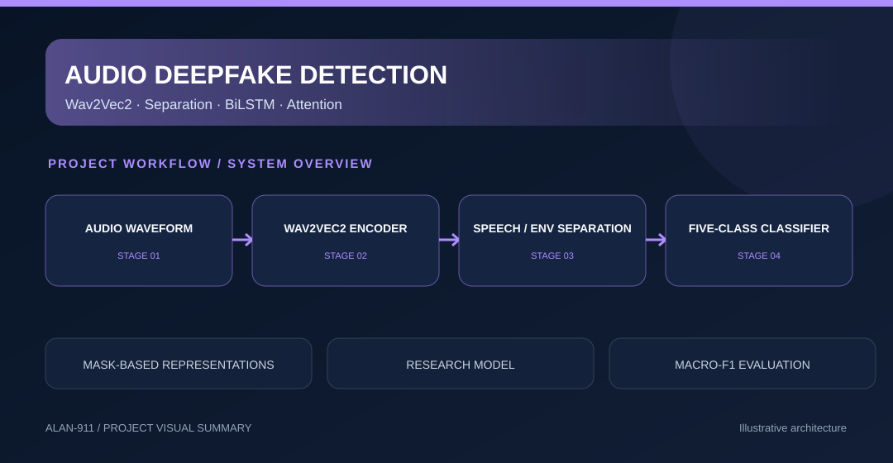

# DPADD-ES — Component-Aware Audio Deepfake Detection

**Speech authenticity research · PyTorch · Wav2Vec2 · Component separation · Five-class classification**

[Research showcase](https://dpadd-es.vercel.app) · [Model implementation](src/model.py) · [Training code](train.py) · [Evaluation code](evaluate.py)

## Research architecture at a glance



*Conceptual model pipeline. Experimental metrics and reproduction limits are documented below.*

## Research question

Can a speech-authentication model better distinguish manipulated speech by separating speech-related and environmental acoustic representations? This repository implements an experimental architecture for the ICME 2026 ESDD2 / CompSpoofV2 audio-deepfake classification task.

**Research affiliation:** Multimodal Artificial Intelligence Laboratory (MAIL), The Catholic University of America.

## Approach

```text
Audio waveform
   → pretrained Wav2Vec2 feature encoder
   → mask-based speech/environment separation
   → two learned representation branches
   → feature fusion + bidirectional LSTM
   → multi-head attention
   → five-class classifier
```

The training objective combines cross-entropy classification loss with a separation/orthogonality term. A ResNet baseline is also implemented for comparison.

| Component | Source |
| --- | --- |
| Model and baseline | [src/model.py](src/model.py) |
| Separation module | [src/separation.py](src/separation.py) |
| Dataset processing | [src/dataset.py](src/dataset.py) |
| Training, resume and checkpoints | [train.py](train.py) |
| Evaluation: macro-F1, EER, class report, plots | [evaluate.py](evaluate.py) |
| Inference and submissions | [infer.py](infer.py), [generate_submission.py](generate_submission.py) |

## Reported research results

The original project documentation reports the following CompSpoofV2 experiments:

| Model | Validation macro-F1 | Test macro-F1 |
| --- | ---: | ---: |
| ESDD2 baseline | 0.9462 | 0.6327 |
| DPADD-ES | 0.9201 | 0.8923 |

**Evidence note:** These are project-reported experiment results, **not freshly reproduced by this repository review**. The repository currently has placeholder directories in `models/` and `results/`, rather than published checkpoints and raw run logs. A reproducibility package with saved configs, training logs, checkpoints (where redistribution is permitted), and evaluation splits would strengthen the claim.

## Reproduction

Requires the separately obtained CompSpoofV2 dataset and an environment compatible with the dependencies in [requirements.txt](requirements.txt). Download and use the dataset only under its license and access conditions.

```bash
git clone https://github.com/Alan-911/Audio-Deepfake-Detection.git
cd Audio-Deepfake-Detection
python -m venv .venv
# Activate the environment for your operating system
pip install -r requirements.txt

# Train (requires data in ./data/CompSpoofV2)
python train.py --data_dir ./data/CompSpoofV2 --epochs 30

# Evaluate an existing checkpoint
python evaluate.py --checkpoint models/best_model.pth --data_dir ./data/CompSpoofV2

# Classify an audio sample using a trained checkpoint
python infer.py --help
```

See `python train.py --help` and `python evaluate.py --help` for additional options. Pretrained Wav2Vec2 weights may be downloaded by the Transformers library when first used.

## Scope and limitations

- Five-class deepfake detection is a research problem; results can change across speakers, recording conditions and unseen generation systems.
- Dataset files and trained weights are **not included** in this public repository.
- This repository does not currently provide a continuous-integration test suite or downloadable experimental run artifacts.
- The linked showcase demonstrates project presentation; it is not, by itself, evidence of reproducible evaluation.

## Research citation

See [CITATION.cff](CITATION.cff) for the project's citation metadata. Confirm publication or challenge-participation status separately from repository availability.

**Maintainer:** Yves Alain Iragena · [Portfolio](https://alan-911.github.io/my-portfolio/)
